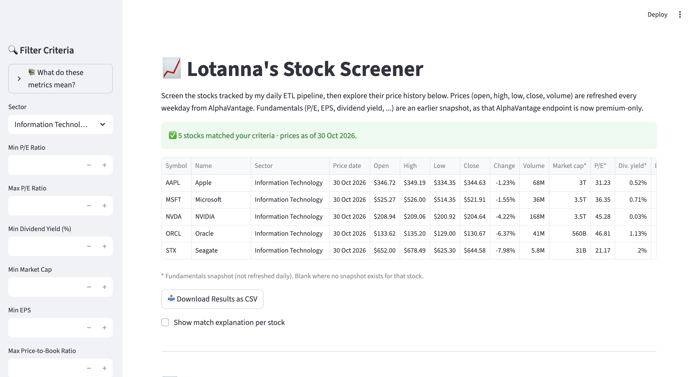
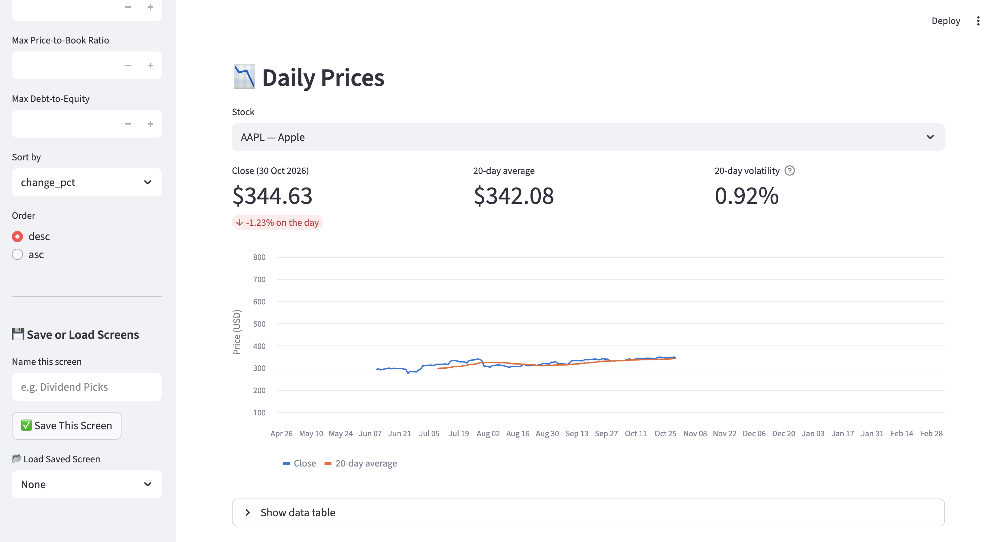
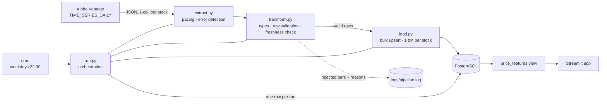

# 📈 Stock Market ETL Pipeline

[](https://github.com/lotannaezeuko/stock-analysis/actions/workflows/tests.yml)

A scheduled Python ETL pipeline that ingests daily market data from the
[Alpha Vantage](https://www.alphavantage.co/) API, validates and transforms it, and loads it
into a PostgreSQL schema designed for predictive modelling. A Streamlit app on top lets you
screen stocks and explore their price history.

- **Extract:** daily OHLCV bars for a configurable universe of stocks, paced to the API's rate limit
- **Transform:** typed, exact-decimal rows; every bar validated, bad bars rejected with a reason
- **Load:** idempotent bulk upserts, one transaction per stock, with run-level lineage
- **Model-ready:** a `price_features` view with returns, moving averages, volatility and a
  next-day target, built point-in-time to avoid look-ahead bias
- **Operable:** scheduled with cron, every run audited in the database, logs tagged by run ID,
  non-zero exit codes on failure, and 42 automated tests run in CI

## Screenshots

**Stock screener:** every tracked stock with its latest prices and daily change, filterable by sector and fundamentals.



**Daily prices:** price history against the 20-day moving average, with the latest close, 20-day average and volatility.



---

## Architecture



`run.py` reads the list of active stocks from the database, then runs extract → transform → load
for each one. A failure in one stock is logged and recorded, and the rest still load.

## Data model

All DDL is in [`pipeline/sql/schema.sql`](pipeline/sql/schema.sql). It's re-runnable
(`IF NOT EXISTS` / `OR REPLACE`).

| Object | Kind | Grain | Notes |
|---|---|---|---|
| `symbols` | Dimension | 1 row per stock | The tracked universe. `is_active` pauses a stock without deleting its history. Adding a stock is a data change, not a code change. |
| `daily_prices` | Fact | 1 row per stock per trading day | Natural key `(symbol, trade_date)`. `NUMERIC` prices. `CHECK` constraints reject impossible bars. `run_id` records which run wrote each row. |
| `quarterly_earnings` | Fact | 1 row per stock per fiscal quarter | Stores `reported_date` separately from `fiscal_date_ending`, so features only use numbers once they were public. |
| `pipeline_runs` | Audit | 1 row per pipeline run | Start/finish time, status (`succeeded` / `partial` / `failed`), counts and error summary. |
| `price_features` | View | 1 row per stock per trading day | Model-ready features (below). |
| `latest_prices` | View | 1 row per stock | Newest bar plus % change from the previous trading day. This is what the screener reads. |

**`price_features`** has these columns:
- `return_1d`
- `sma_5`, `sma_20`
- `volatility_20d`
- `volume_ratio_20d`
- `last_reported_eps`, `last_eps_surprise_pct`, `days_since_earnings`
- `next_day_return`, the prediction target

It follows these rules:
- **Windows count trading days** (`ROWS BETWEEN`), not calendar days.
- **No partial windows.** `sma_20` is `NULL` until 20 days of history exist, rather than an
  average of fewer rows.
- **Point-in-time earnings.** Each day joins the latest report published *strictly before* that
  day (`reported_date < trade_date`), so there's no look-ahead bias.
- **`next_day_return` is the label.** It deliberately looks one day ahead and must never be used
  as an input feature.

## Data quality

Bad data is caught in four layers:

| Layer | Where | Catches |
|---|---|---|
| API errors | `extract.py` | Alpha Vantage returns **HTTP 200** for rate limits and errors, putting the message in a `Note` / `Information` / `Error Message` key. These are raised as errors, never loaded. |
| Row validation | `transform.py` | Unparseable values, missing fields, `NaN`, non-positive prices, negative volume, open/close outside the low–high range. Each bad bar is rejected **with a reason**, and the rest of the stock's bars still load. |
| Dataset validation | `transform.py` | **Freshness**: if a stock's newest bar is more than 7 days old, the whole stock fails. This was added after a live run where one ticker returned perfectly valid-looking bars that were 5 months stale. |
| Database constraints | `schema.sql` | The same rules as `CHECK` constraints, plus a foreign key to `symbols`. They're the last line of defence, so the table can't hold invalid data even if something bypasses the pipeline. |

## Reliability

- **Idempotent loads.** Upserts on `(symbol, trade_date)` mean re-running a day, a stock or the
  whole pipeline never creates duplicates. Each run fetches the last ~100 trading days, so
  **missed runs heal themselves** on the next run.
- **Atomic per stock.** Each stock loads in one transaction, so a crash can't leave half a stock
  loaded.
- **Failure isolation.** One stock failing doesn't stop the others. The run is marked `partial`.
- **Rate limiting.** Calls are spaced 2 seconds apart, using a monotonic clock so system clock
  changes can't break the pacing.
- **Exit codes.** `0` only if every stock succeeded. Anything else exits `1`, so the scheduler
  can flag it.

## Observability

Every log line is tagged with its run ID and written to the terminal and to `logs/pipeline.log`
(rotated at 1 MB):

```
2026-11-02 22:30:01 INFO [run 14] pipeline.run: Run started: 20 symbols to process
2026-11-02 22:30:01 INFO [run 14] pipeline.run: AAPL: 100 rows loaded, 0 rejected
2026-11-02 22:30:41 INFO [run 14] pipeline.run: Run succeeded: 20 succeeded, 0 failed, 2000 rows loaded
```

Check recent runs:

```sql
SELECT run_id, started_at, finished_at - started_at AS duration, status,
       symbols_attempted, symbols_failed, rows_loaded, error
FROM pipeline_runs
ORDER BY run_id DESC
LIMIT 10;
```

Trace any row back to the run that wrote it: `SELECT run_id, loaded_at FROM daily_prices WHERE ...`.
Then `grep "\[run 14\]" logs/pipeline.log`.

---

## Getting started

**Prerequisites:** Python 3.11+, PostgreSQL 14+, and a free
[Alpha Vantage API key](https://www.alphavantage.co/support/#api-key).

```bash
git clone https://github.com/lotannaezeuko/stock-analysis.git
cd stock-analysis

python3 -m venv .venv
source .venv/bin/activate
pip install -r requirements-dev.txt

cp .env.example .env
```

Edit `.env` with your API key and database URL. Then create the database, schema and stock list:

```bash
set -a; source .env; set +a

createdb stocks
psql "$DATABASE_URL" -v ON_ERROR_STOP=1 -f pipeline/sql/schema.sql
psql "$DATABASE_URL" -v ON_ERROR_STOP=1 -f pipeline/sql/seed_symbols.sql
```

### Running the pipeline

```bash
python -m pipeline.run
python -m pipeline.run AMZN CL
```

The first command processes every active stock. The second re-runs only the stocks you name,
which is useful for retrying failures without spending the whole API budget.

**API budget:** the free tier allows 25 calls a day and 1 per second. The seed tracks
20 active stocks, so one daily run uses 20 calls (about 40 seconds).

### Changing which stocks are tracked

Edit [`pipeline/sql/seed_symbols.sql`](pipeline/sql/seed_symbols.sql) and re-run it. You can also
change the table directly:

```sql
UPDATE symbols SET is_active = FALSE WHERE symbol = 'LUV';
INSERT INTO symbols (symbol, name, sector) VALUES ('JNJ', 'Johnson & Johnson', 'Healthcare');
```

Re-running the seed adds and updates stocks but never deletes them. To remove a stock completely,
delete its `daily_prices` rows first, then its `symbols` row.

## Scheduling

The pipeline runs on weekday evenings, after the US market closes. Run times are in your
machine's local time; 22:30 UK time is after the 16:00 New York close all year round.
[`scripts/run_pipeline.sh`](scripts/run_pipeline.sh) is a small wrapper that moves into the repo
and uses the project's virtualenv, because cron starts jobs with a minimal environment.

**1. Check that the wrapper works:**

```bash
mkdir -p logs
scripts/run_pipeline.sh
echo $?
```

**2. Open your crontab:**

```bash
crontab -e
```

**3. Add this line** (use your own absolute path), then save and quit:

```
30 22 * * 1-5 /Users/you/Developer/stock-analysis/scripts/run_pipeline.sh >> /Users/you/Developer/stock-analysis/logs/cron.log 2>&1
```

`30 22 * * 1-5` means 22:30, Monday to Friday. `logs/cron.log` catches anything printed before
the pipeline's own logging starts, such as a missing `.venv`.

**4. Confirm it's installed:**

```bash
crontab -l
```

The next morning, check `pipeline_runs` (see [Observability](#observability)) or
`tail logs/pipeline.log`.

**On a Mac:**
- cron doesn't run while the machine is asleep. A missed run is simply skipped, and because
  every run fetches the last ~100 days, the next run fills the gap.
- If the repo is inside `Desktop`, `Documents` or `Downloads`, give `/usr/sbin/cron` **Full Disk
  Access** in *System Settings → Privacy & Security*.

**To stop the schedule:** run `crontab -e` and delete the line.

## Tests

```bash
pytest
```

Unit tests cover extract and transform. They use real Alpha Vantage responses saved in
`tests/fixtures/` with the HTTP layer mocked, so they need no network and no API quota.

Integration tests run the real schema, upserts, constraints, full pipeline runs and the
`price_features` view against PostgreSQL. To enable them, point `TEST_DATABASE_URL` at a
disposable database:

```bash
createdb stock_analysis_test
TEST_DATABASE_URL=postgresql:///stock_analysis_test pytest -v
```

The test database is wiped before every test. As a guard rail, the tests refuse to run against any
database whose name doesn't end in `_test`. In CI, [GitHub Actions](.github/workflows/tests.yml)
runs the whole suite against a PostgreSQL 17 service container on every push.

## Screener app

```bash
streamlit run backend/app.py
```

- **Screener:** lists every stock the pipeline tracks with its latest **open, high, low, close,
  volume and daily change**, refreshed each weekday. You can filter by sector and by fundamentals
  (P/E, dividend yield, market cap, EPS, P/B, debt-to-equity), sort by any column, save and load
  screens, and export to CSV. The fundamentals are an earlier snapshot, because Alpha Vantage's
  `OVERVIEW` endpoint is now premium-only. They're blank for stocks added after it was taken.
- **Daily prices:** pick any tracked stock to see its latest close and daily change, its 20-day
  average and volatility, and a price chart against the 20-day moving average.

---

## Project structure

```
pipeline/
  run.py            orchestration, run auditing, logging, CLI
  extract.py        Alpha Vantage client: pacing, timeouts, error detection
  transform.py      parsing, row validation, freshness check
  load.py           bulk idempotent upserts
  db.py             connections, symbol list, pipeline_runs
  config.py         settings from environment / .env
  sql/
    schema.sql      tables, constraints, price_features view
    seed_symbols.sql
scripts/
  run_pipeline.sh   cron wrapper
tests/              pytest unit + integration tests, saved API fixtures
backend/            Streamlit screener app
```

## Design decisions

| Decision | Why |
|---|---|
| Daily prices rather than the fundamentals endpoint | `OVERVIEW` became premium. Daily bars are free, are real market data, and build a time series, which is what predictive models need. |
| Re-fetch ~100 days every run and upsert | Simpler than tracking a high-water mark, and it heals missed runs and picks up vendor corrections. At ~2,000 rows the extra writes cost nothing. |
| `Decimal` / `NUMERIC` instead of `float` | Prices are stored exactly (30.51, not 30.50999…). |
| Validation in Python *and* constraints in Postgres | Python gives friendly per-row rejection with reasons. The database guarantees integrity for every writer, not just this pipeline. |
| Stock list in a table, not in code | One source of truth. Stocks can be paused or added without a deploy, and the foreign key stops prices being loaded for unknown stocks. |
| cron rather than an orchestrator | One job, one machine, ~40 seconds a day. Airflow or Dagster would add more moving parts than the job itself. |

## Limitations & next steps

- **A small, hand-picked universe.** The free tier allows 25 calls a day, so the pipeline tracks
  20 stocks, chosen to reflect my interests (tech) plus a spread of other sectors. It isn't a
  full market. Covering more would need a paid key, or rotating stocks across days.
- **Fundamentals are frozen.** P/E, EPS and the other fundamentals are a one-off snapshot, so a P/E
  next to today's price reflects an older price. Next step: recompute P/E from the latest close
  and trailing EPS from `quarterly_earnings`.
- **Unadjusted prices.** Adjusted prices are premium-only, so a stock split shows up as a fake
  large return. Next step: a splits table, or the adjusted endpoint on a paid key.
- **Earnings ingestion.** The `quarterly_earnings` table and point-in-time join are built and
  tested. Ingesting from the free `EARNINGS` endpoint, using the 5 spare daily calls, is next.
- **Retries.** A transient error currently fails that stock until the next run. Adding retries
  with backoff for rate-limit and 5xx responses would fix this.
- **Cloud scheduling.** Move the database to a hosted Postgres (e.g. Supabase) and run the
  pipeline from a scheduled GitHub Actions workflow, so it doesn't depend on a laptop being awake.
